&nbsp;

<div align="center">

<p align="center"> 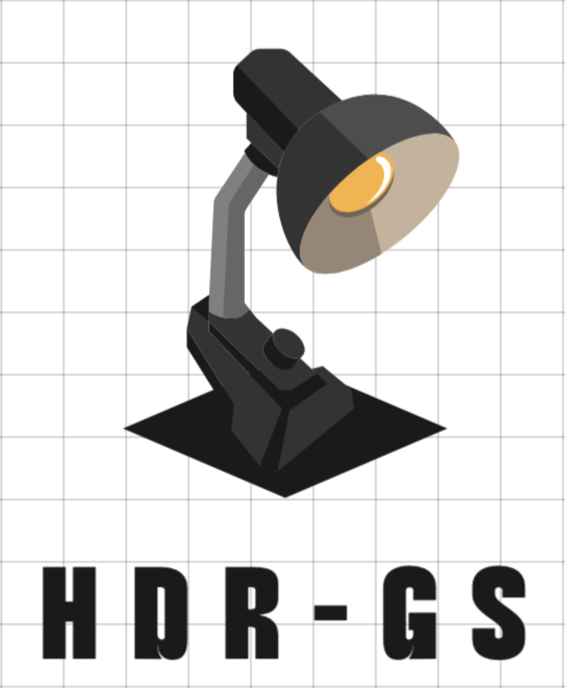 </p>


[](https://arxiv.org/abs/2405.15125) [](https://www.youtube.com/watch?v=wtU7Kcwe7ck) [](https://zhuanlan.zhihu.com/p/10016024329) [](https://caiyuanhao1998.github.io/project/HDR-GS/) [](https://x.com/_akhaliq/status/1794921228462923925?s=46) [](https://x.com/janusch_patas/status/1794932286397489222?s=46)  [](https://huggingface.co/datasets/CaiYuanhao/HDR-GS) [](https://huggingface.co/CaiYuanhao/HDR-GS) [](https://huggingface.co/spaces/CaiYuanhao/HDR-GS)

<h4>HDR-GS: Efficient High Dynamic Range Novel View Synthesis at 1000x Speed via Gaussian Splatting</h4> 

|                          *Scene Bathroom*                           |                          *Scene Chair*                           |                          *Scene Dog*               
| :----------------------------------------------------------: | :----------------------------------------------------------: | :----------------------------------------------------------: |
|  |  |  |

|                          *Scene Bear*                           |                          *Scene Desk*                           |                          *Scene Sponza*               
| :----------------------------------------------------------: | :----------------------------------------------------------: | :----------------------------------------------------------: |
|  |  |  |

&nbsp;

</div>


### Introduction
This is the official implementation of our NeurIPS 2024 paper "HDR-GS: Efficient High Dynamic Range Novel View Synthesis at 1000x Speed via Gaussian Splatting". We have run the SfM algorithm to recalibrate the data. If you find this repo useful, please give it a star ⭐ and consider citing our paper. Thank you.

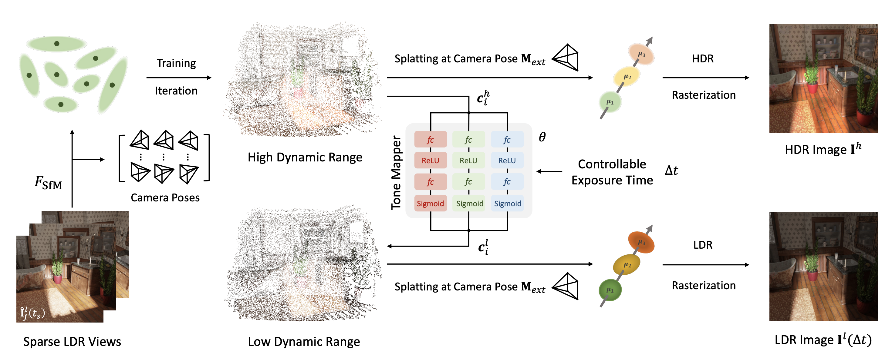

### News
- **2026.11.18** · We released the [online Gradio demo](https://huggingface.co/spaces/CaiYuanhao/HDR-GS) for LDR/HDR novel-view synthesis and interactive Gaussian point clouds.
- **2026.11.15 :** We have built the [project page](https://caiyuanhao1998.github.io/project/HDR-GS/) with novel-view reconstruction videos and interactive Gaussian point clouds. 🚀
- **2026.11.08 :** We have released our dataset and models on HuggingFace 🤗
- **2024.12.01 :** We provide code for direct loading model to test and render spiral demo video. Welcome to have a try! 🤗
- **2024.11.30 :** We set up a leaderboard on the [paper-with-code](https://paperswithcode.com/sota/novel-view-synthesis-on-hdr-gs) website! Welcome to submit your entry! 🏆
- **2024.11.26 :** Code, recalibrated data following the opencv standard, and training logs have been released. Feel free to check and have a try! 🤗
- **2024.07.01 :** Our HDR-GS has been accepted by NeurIPS 2024! Code will be released before the start date of the conference (2024.12.10). Stay tuned. 🚀
- **2024.05.24 :** Our paper is on [arxiv](https://arxiv.org/abs/2405.15125) now. Code, data, and training logs will be released. Stay tuned. 💫

### Performance

<details close>
<summary><b>Synthetic Datasets</b></summary>

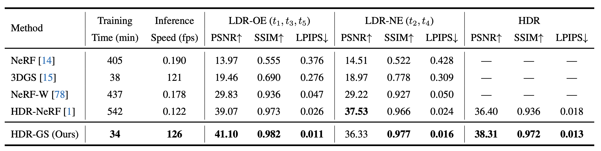


</details>

<details close>
<summary><b>Real Datasets</b></summary>

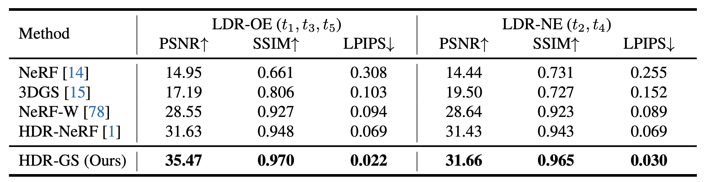

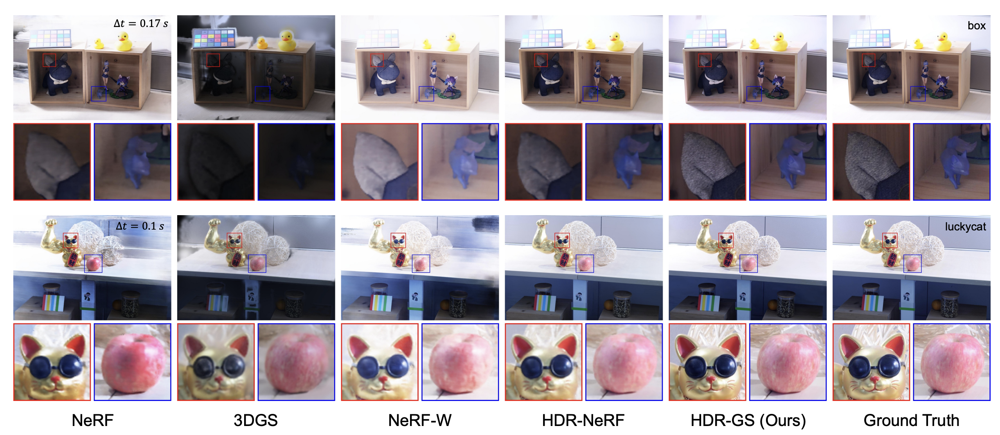

</details>

&nbsp;

### Interactive Results
|                          *Scene Bathroom*                           |                          *Scene Chair*                           |                          *Scene Diningroom*                           |
| :----------------------------------------------------------: | :----------------------------------------------------------: | :----------------------------------------------------------: |
| [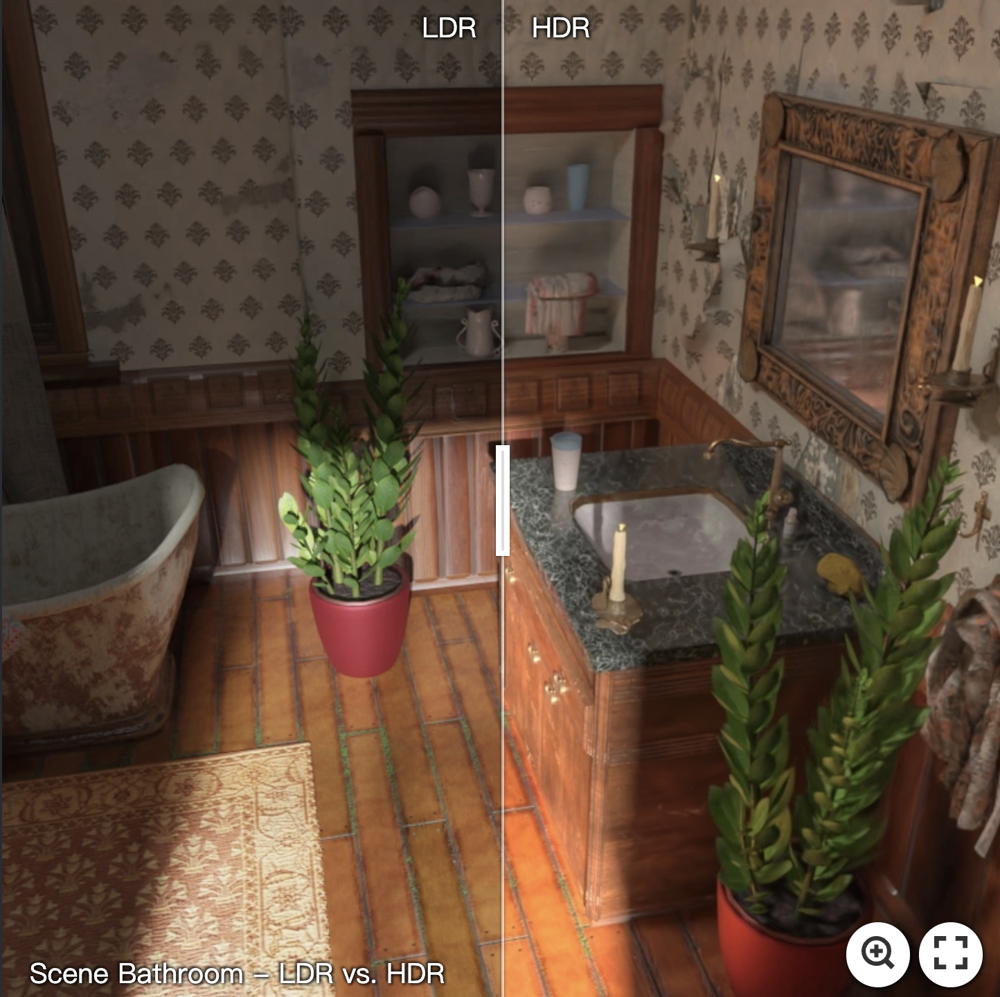](https://imgsli.com/MzIzNTAw) | [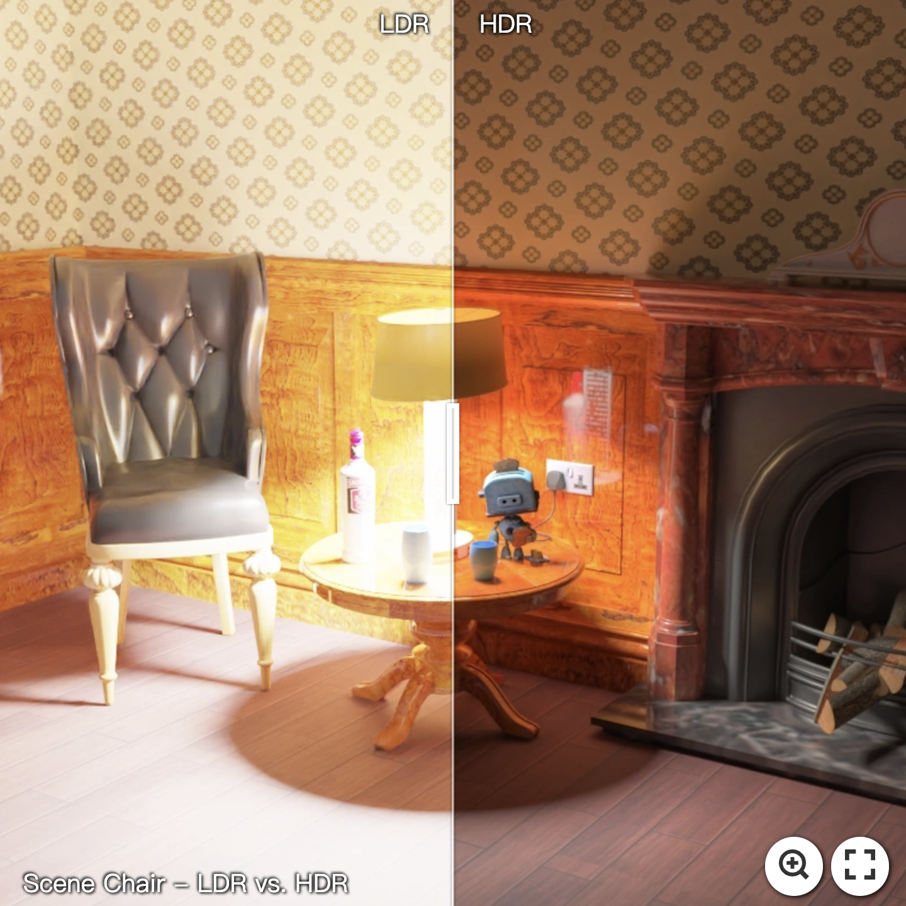](https://imgsli.com/MzIzNTAx) | [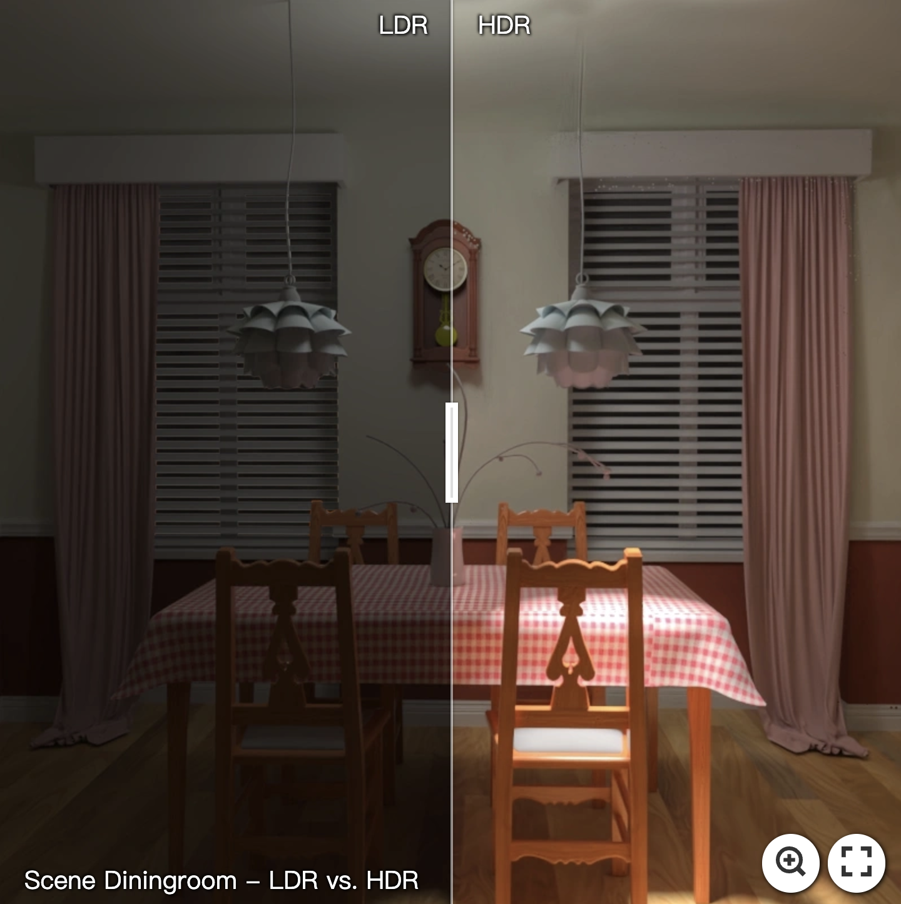](https://imgsli.com/MzIzNTAy) |

|                          *Scene Dog*                           |                          *Scene Sofa*                           |                          *Scene Sponza*                           |
| :----------------------------------------------------------: | :----------------------------------------------------------: | :----------------------------------------------------------: |
| [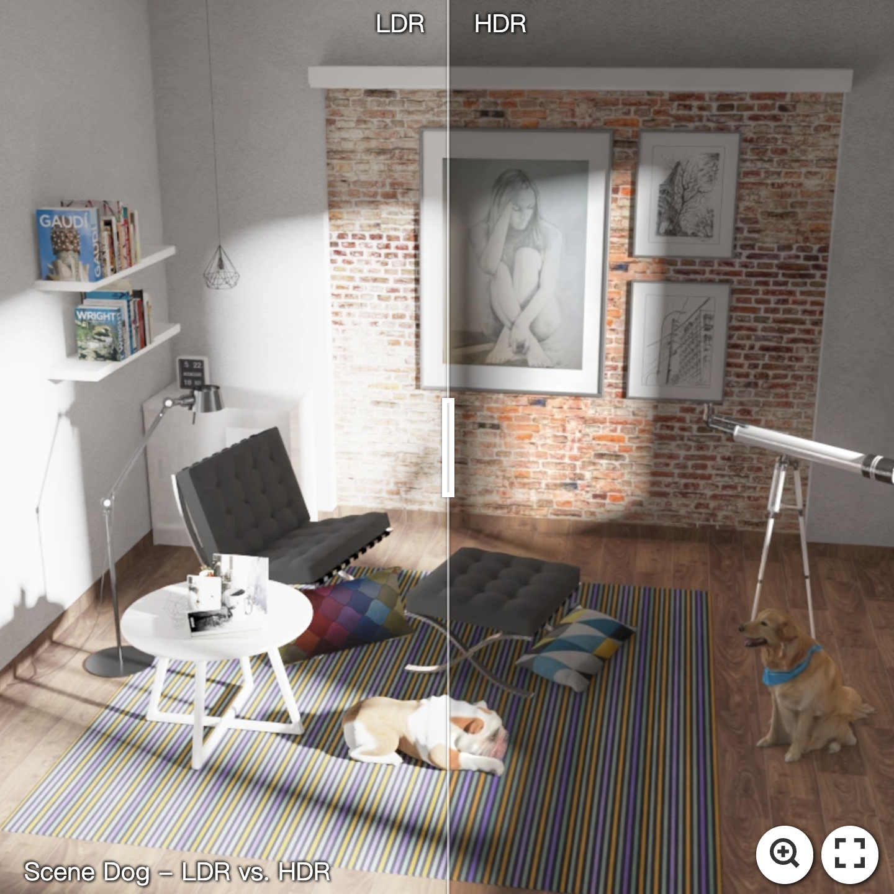](https://imgsli.com/MzIzNTA0) | [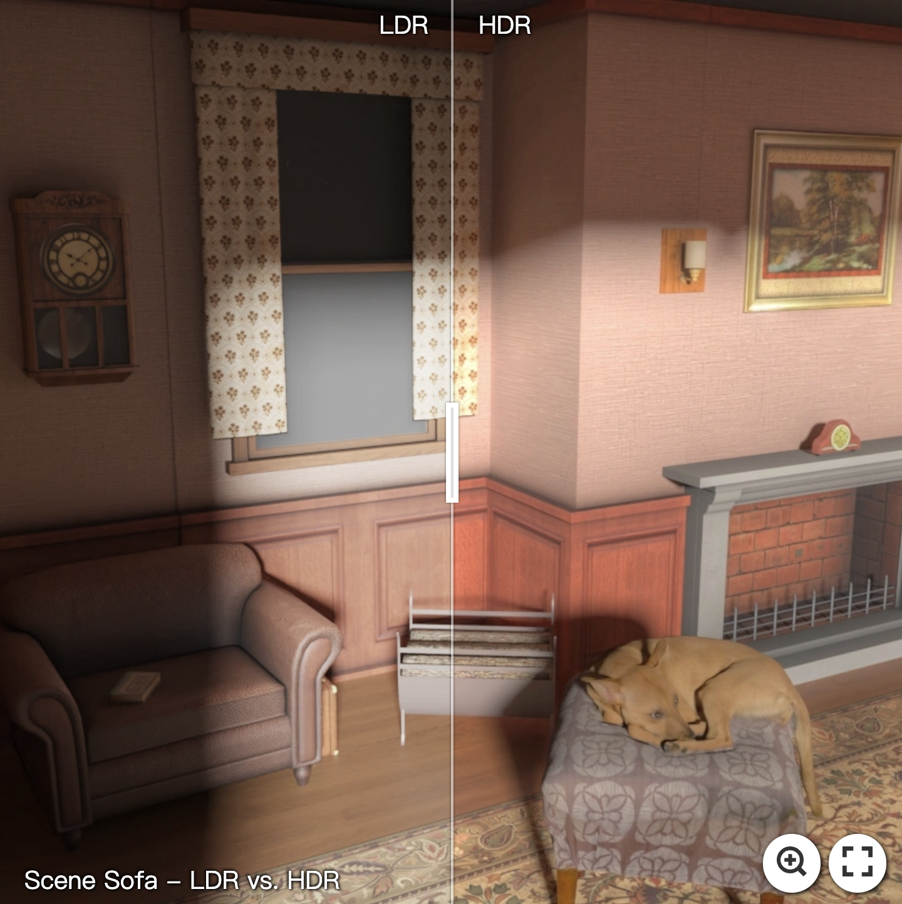](https://imgsli.com/MzIzNTA1) | [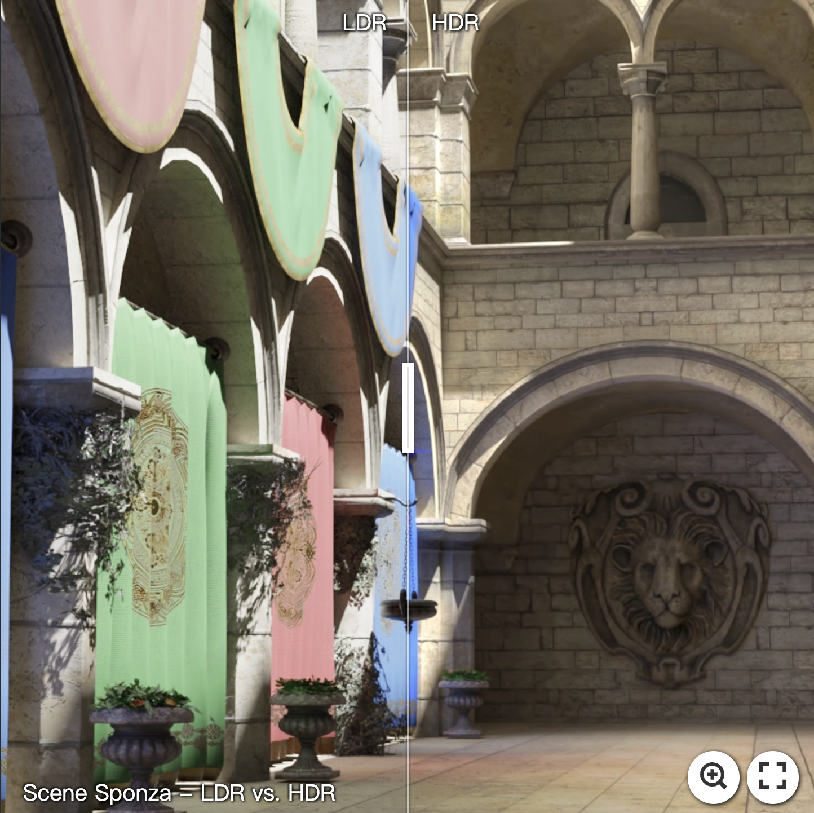](https://imgsli.com/MzIzNTA2) |


&nbsp;

## 1. Create Environment

We recommend using [Conda](https://docs.conda.io/en/latest/miniconda.html) to set up the environment.

```shell
git clone https://github.com/caiyuanhao1998/HDR-GS --recursive
cd HDR-GS
conda env create --file environment.yml
conda activate hdr_gs
```

A CUDA development toolkit (`nvcc`) and a compatible C++ compiler are required to build the two CUDA extensions. The Conda `cudatoolkit` package supplies runtime libraries, not `nvcc`. The configuration below has been tested with CUDA 11.8 and GCC 11 on Linux.

On Linux with a newer system compiler (for example GCC 12 or 13), install a compatible compiler before building:

```shell
conda install -c conda-forge gcc_linux-64=11 gxx_linux-64=11 libxcrypt
conda deactivate
conda activate hdr_gs
export CPATH="${CONDA_PREFIX}/include${CPATH:+:${CPATH}}"
```

Copy these commands as written; no variable needs to be filled in manually. `conda activate` sets `CONDA_PREFIX` to the active environment directory. The last command adds that environment's `include/` directory to the compiler's header search path. `${CPATH:+:${CPATH}}` appends a colon and the existing `CPATH` value only when it is nonempty.

Then build the extensions in the activated environment, after PyTorch is installed:

```shell
python -m pip install --no-build-isolation ./submodules/diff-gaussian-rasterization ./submodules/simple-knn
python -c "import torch, diff_gaussian_rasterization, simple_knn._C; print(torch.__version__, torch.cuda.is_available())"
```

For Windows, use a CUDA-compatible Visual Studio build environment and run `set DISTUTILS_USE_SDK=1` in Command Prompt before the extension installation command. The Linux compiler command above is not needed on Windows.


Install all Gradio demo dependencies here in the Python 3.11 UI environment.

```shell
conda create -n hdr_gs_demo python=3.11 pip -y
conda run -n hdr_gs_demo python -m pip install -r demo/requirements.txt
```

Keep `hdr_gs` active for Section 3. The Gradio UI runs in `hdr_gs_demo` and calls the CUDA renderer in `hdr_gs`; `CONDA_PREFIX` is filled automatically by Conda. Camera formats and render options are documented in the [rendering guide](docs/rendering.md).


&nbsp;

## 2. Prepare Dataset

Download our recalibrated and reorganized datasets from [Google Drive](https://drive.google.com/file/d/1-9K8_iFwFH3SeTcRoaOTed-h9GBdRrrr/view?usp=sharing) or [Baidu Disk](https://pan.baidu.com/s/1wXxaTd9qwLUo2jVLO8jilg?pwd=cyh2) (code: `cyh2`). Put the downloaded datasets into `data_hdr/`.

Alternatively, download the data from [](https://huggingface.co/datasets/CaiYuanhao/HDR-GS) using Git LFS. With [Git LFS](https://git-lfs.com/) installed, run these commands from the project root:

```shell
git lfs install
git clone https://huggingface.co/datasets/CaiYuanhao/HDR-GS data_hdr
```

This downloads `synthetic/` and `real/` directly into `data_hdr/`, with the following layout:

```sh
  |--data_hdr
    |--synthetic
      |--bathroom
        |--exr
          |--0.exr
          |--1.exr
          ...
        |--images
          |--0_0.png
          |--0_1.png
          ...
        |--sparse
          |--0
            |--cameras.bin
            |--images.bin
            |--points3D.bin
            |--points3D.ply  
            |--project.ini
      |--bear
      ...
    |--real
      |--flower
        |--input_images
          |--000_0.jpg
          |--000_1.jpg
          ...
        |--poses_bounds_exps.npy
        |--sparse
          |--0
            |--cameras.bin
            |--images.bin
            |--points3D.bin
            |--points3D.ply  
            |--project.ini
      |--computer
      ...
```

`Note:` The original datasets are collected by [HDR-NeRF](https://arxiv.org/abs/2111.14451). But the camera poses follow the normalized device coordinates, which are not suitable for 3DGS. Besides, HDR-NeRF does not provide the initial point clouds. So we use the Structure-from-Motion algorithm to recalibrate the camera poses and generate the initial point clouds. We also organize the datasets according to the description of HDR-NeRF, which is different from its official repo.

&nbsp;

Precomputed videos, interactive Gaussian previews, camera paths and HDR samples are organized in the dataset’s [visualizations folder](https://huggingface.co/datasets/CaiYuanhao/HDR-GS/tree/main/visualizations).

## 3. Testing

From the repository root, download all 12 scene checkpoints from [Hugging Face Model](https://huggingface.co/CaiYuanhao/HDR-GS) into `pretrained_weights/` using the environment installed in Section 1.

```shell
conda run --no-capture-output -n hdr_gs_demo hf download CaiYuanhao/HDR-GS --include "config.json" --include "synthetic/**" --include "real/**" --local-dir pretrained_weights
```

The download puts each scene's `point_cloud.ply` and `tone_mapper.pth` in `pretrained_weights/synthetic/<scene>/` or `pretrained_weights/real/<scene>/`. The Bathroom and Sofa directories are `pretrained_weights/synthetic/bathroom/` and `pretrained_weights/synthetic/sofa/`.

The root `config.json` indexes the scene checkpoints and is used by Hugging Face for [download statistics](https://huggingface.co/docs/hub/models-download-stats).

### Gradio demo

Explore paired LDR/HDR videos and Gaussian point clouds for all 12 scenes in the [online demo](https://huggingface.co/spaces/CaiYuanhao/HDR-GS). To launch locally, keep the `hdr_gs` Conda environment active after Section 1.

[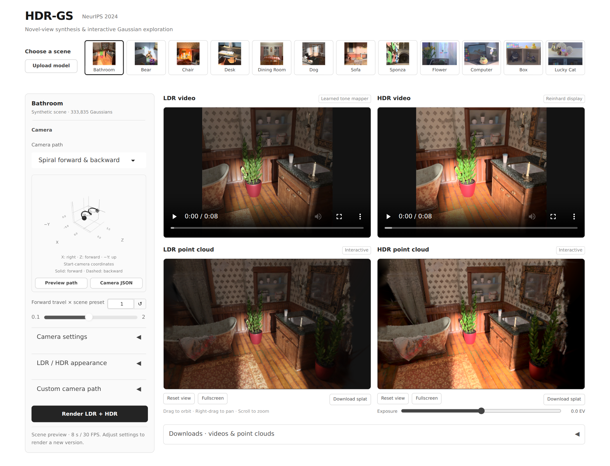](https://huggingface.co/spaces/CaiYuanhao/HDR-GS)

```shell
conda run --no-capture-output -n hdr_gs_demo python demo/app.py --renderer-python "$CONDA_PREFIX/bin/python" --models-root pretrained_weights --gpu-id 0 --port 7876
```

### LDR rendering

```shell
python render_ldr.py --scene bathroom --model_path pretrained_weights/synthetic/bathroom --output output/videos/bathroom --gpu_id 0
python render_ldr.py --scene bathroom --model_path pretrained_weights/synthetic/bathroom --output output/videos/bathroom_fixed --gpu_id 0 --brightness 0.35
```

### HDR rendering

```shell
python render_hdr.py --scene bathroom --model_path pretrained_weights/synthetic/bathroom --output output/videos/bathroom --gpu_id 0
```

### Evaluation

Download the scene data in Section 2, then use the matching evaluation command.

```shell
# For synthetic scenes
python3 train_synthetic.py --config config/bathroom.yaml --eval --gpu_id 0 --syn --load_path pretrained_weights/synthetic/bathroom --test_only
python3 train_synthetic.py --config config/bear.yaml --eval --gpu_id 0 --syn --load_path pretrained_weights/synthetic/bear --test_only
python3 train_synthetic.py --config config/chair.yaml --eval --gpu_id 0 --syn --load_path pretrained_weights/synthetic/chair --test_only
python3 train_synthetic.py --config config/desk.yaml --eval --gpu_id 0 --syn --load_path pretrained_weights/synthetic/desk --test_only
python3 train_synthetic.py --config config/diningroom.yaml --eval --gpu_id 0 --syn --load_path pretrained_weights/synthetic/diningroom --test_only
python3 train_synthetic.py --config config/dog.yaml --eval --gpu_id 0 --syn --load_path pretrained_weights/synthetic/dog --test_only
python3 train_synthetic.py --config config/sofa.yaml --eval --gpu_id 0 --syn --load_path pretrained_weights/synthetic/sofa --test_only
python3 train_synthetic.py --config config/sponza.yaml --eval --gpu_id 0 --syn --load_path pretrained_weights/synthetic/sponza --test_only
```

```shell
# For real scenes
python3 train_real.py --config config/flower.yaml --eval --gpu_id 0 --load_path pretrained_weights/real/flower --test_only
python3 train_real.py --config config/computer.yaml --eval --gpu_id 0 --load_path pretrained_weights/real/computer --test_only
python3 train_real.py --config config/box.yaml --eval --gpu_id 0 --load_path pretrained_weights/real/box --test_only
python3 train_real.py --config config/luckycat.yaml --eval --gpu_id 0 --load_path pretrained_weights/real/luckycat --test_only
```

To evaluate a checkpoint you trained, use its saved checkpoint directory as `--load_path` in the matching command above. The directory contains `point_cloud.ply` and `tone_mapper.pth`.

Testing also saves `render_*_hdr_preview.png` beside the original HDR EXR files, so ordinary image viewers can display the results. Training losses and evaluation metrics retain the original pipeline.

## 4. Training

Train each scene using the corresponding YAML.

```shell
# For synthetic scenes
python3 train_synthetic.py --config config/sponza.yaml --eval --gpu_id 0 --syn
python3 train_synthetic.py --config config/sofa.yaml --eval --gpu_id 0 --syn
python3 train_synthetic.py --config config/bear.yaml --eval --gpu_id 0 --syn
python3 train_synthetic.py --config config/chair.yaml --eval --gpu_id 0 --syn
python3 train_synthetic.py --config config/desk.yaml --eval --gpu_id 0 --syn
python3 train_synthetic.py --config config/diningroom.yaml --eval --gpu_id 0 --syn
python3 train_synthetic.py --config config/dog.yaml --eval --gpu_id 0 --syn
python3 train_synthetic.py --config config/bathroom.yaml --eval --gpu_id 0 --syn

# For real scenes
python3 train_real.py --config config/flower.yaml --eval --gpu_id 0
python3 train_real.py --config config/computer.yaml --eval --gpu_id 0
python3 train_real.py --config config/box.yaml --eval --gpu_id 0
python3 train_real.py --config config/luckycat.yaml --eval --gpu_id 0
```

To help you debug, we provide the original logs for all 12 scenes on [Google Drive](https://drive.google.com/drive/folders/1lI2nZ51pcW12xaiNFJjvoaHeuawj1dRt) and [Baidu Disk](https://pan.baidu.com/s/17iO_iOHyEyrmdZYgAGK7Sw?pwd=cyh2).

&nbsp;

## 5. Citation
```sh
@inproceedings{hdr_gs,
  title={HDR-GS: Efficient High Dynamic Range Novel View Synthesis at 1000x Speed via Gaussian Splatting},
  author={Yuanhao Cai and Zihao Xiao and Yixun Liang and Minghan Qin and Yulun Zhang and Xiaokang Yang and Yaoyao Liu and Alan Yuille},
  booktitle={NeurIPS},
  year={2024}
}
```
